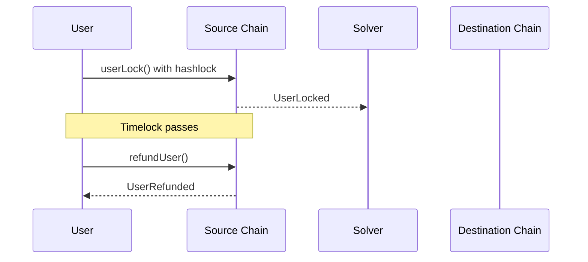
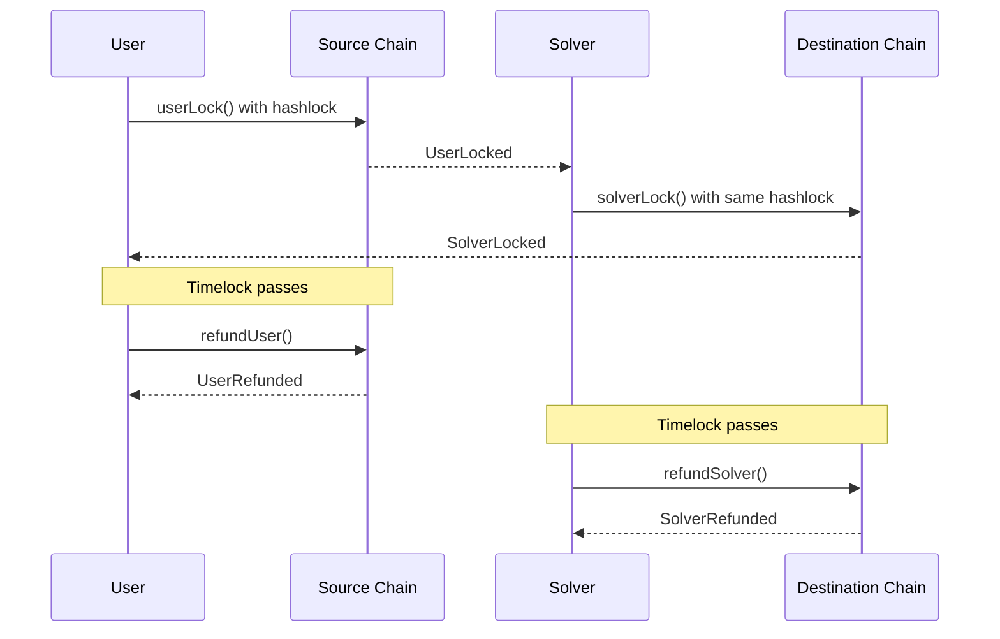
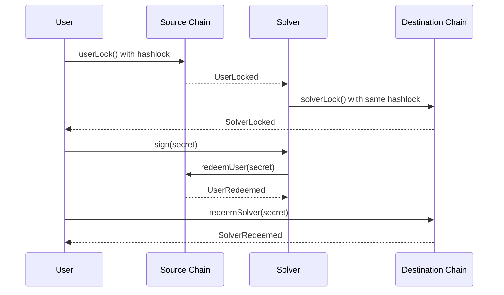
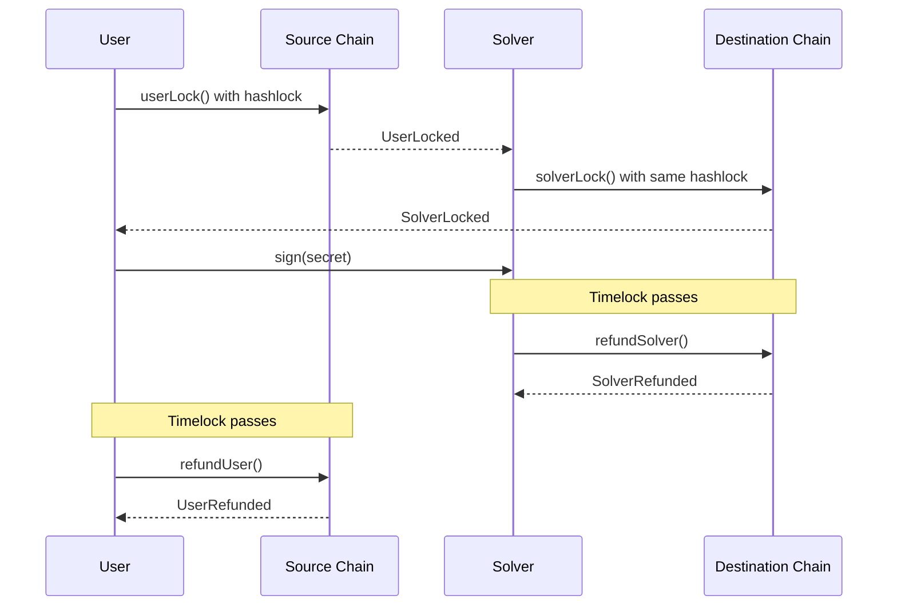

### Solver Fails to Act on the User's Lock
In a rare scenario where the selected Solver fails to act on the User's lock, the User only needs to wait for the timelock period (usually ~15 minutes) to receive their funds back.

<Accordion title="Sequence Diagram" icon="brake-warning">

</Accordion>

### User Fails to Transmit Secret to Solver

If the User does not transmit the derived secret to the Solver in time, both parties can refund their funds after the timelock period expires.

<Accordion title="Sequence Diagram" icon="brake-warning">

</Accordion>

### Solver Fails to Release the User's Funds

In scenarios where the Solver releases their own funds but fails to release the User's funds, the protocol provides two mechanisms:

1. **Manual Redemption**: The User already possesses the secret (they transmitted it to the Solver). If the Solver fails to redeem on the destination chain, the User can directly use the secret to manually redeem their own funds on the destination chain, bypassing the Solver's failure.

2. **Reward Mechanism**: Other actors can redeem on behalf of the user and earn a reward for completing the swap. The original Solver loses their reward by failing to act in time.

<Accordion title="Sequence Diagram" icon="brake-warning">

</Accordion>

### Solver Fails to Release Any Funds

If the Solver fails to release any funds, both the User and Solver can wait for the timelock period to expire and then refund their funds.

<Accordion title="Sequence Diagram" icon="brake-warning">

</Accordion>