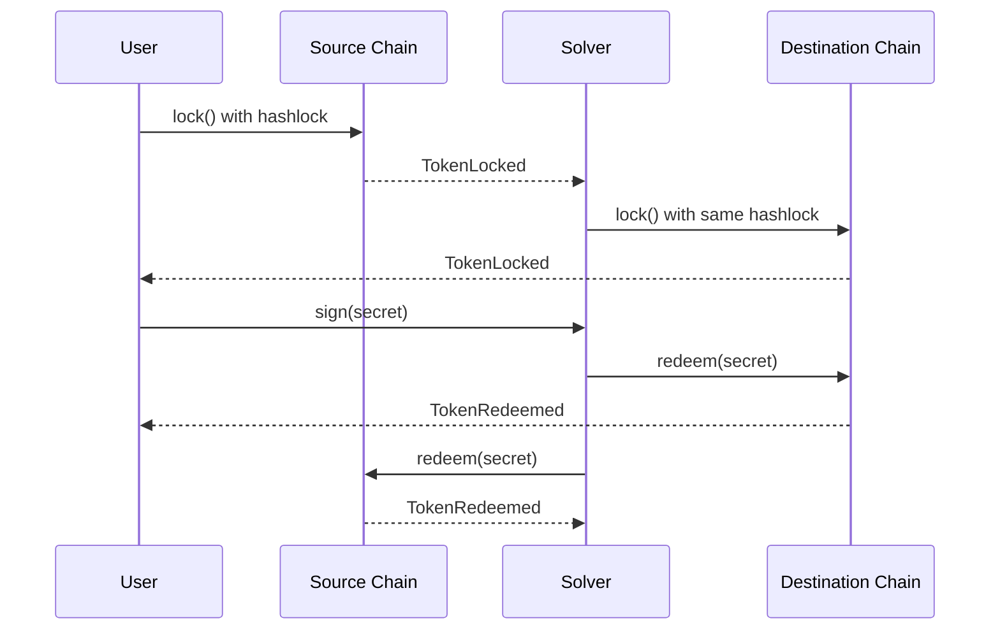
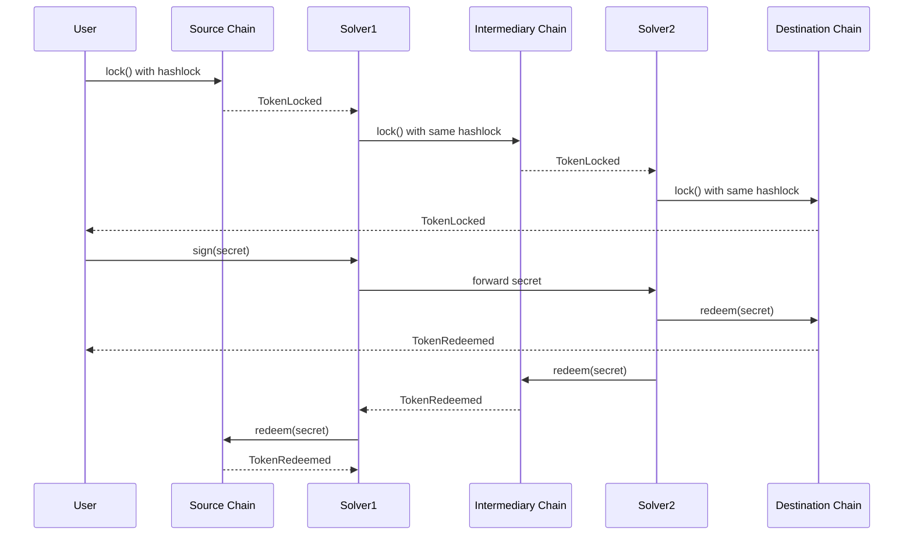

The protocol model relies on atomic swaps with recoverable secret generation for parties exchanging assets across different chains. The model outlines the core flow of assets and actions that should be taken by each party for a successful asset exchange. The protocol uses the [Standard flow](#standard-flow) for asset exchange between parties.

### Standard flow

When a party (Solver) directly supports both the source and destination chains and is willing to perform the swap, the standard flow applies. The user derives a secret using the [recoverable secret generation mechanism](/protocol/atomic-swaps-secret_gen) and locks funds on the source chain with the hashlock of that secret, setting the timelock to $T + \Delta$, where $T$ is the current timestamp and $\Delta$ is a reasonable duration (e.g., 15 minutes). The Solver observes this lock and creates a matching lock on the destination chain with the same hashlock and timelock of $T + 2\Delta$. The user then signs and transmits the derived secret to the Solver. The Solver reveals the secret on both chains to complete the swap.

Here are the steps:

<Steps>
  <Step title="User Derives Secret and Locks">
    The user derives a secret using [HKDF](/protocol-spec/HKDF) and creates a lock object on the source chain with the hashlock and a timelock of $T + \Delta$.
  </Step>
  <Step title="Solver Lock">
    The Solver observes the lock on the source chain and creates a matching lock object on the destination chain with the same hashlock and a timelock of $T + 2\Delta$.
  </Step>
  <Step title="User Transmits Signed Secret">
    The user signs and transmits the derived secret to the Solver via off-chain channels.
  </Step>
  <Step title="Solver Reveals and Redeems">
    The Solver reveals the secret on the destination chain to unlock the user's funds (earning a reward for this action), then reveals it on the source chain to claim their primary fee. The Solver is economically incentivized to complete the destination redemption promptly—if they delay, any other actor can step in and claim the reward instead.
  </Step>
</Steps>

<Accordion title="Standard transaction sequence diagram" icon="arrows-left-right">

</Accordion>

{/*
### Multi-hop flow

When transferring funds from a source chain to a destination chain is not possible due to the absence of a party directly linking the two, a multi-hop approach is used, with the chain length denoted as $n$. In this process, the user derives a secret and locks funds on the source chain to the first Solver. Each Solver in the sequence subsequently locks funds for the next Solver in the chain, until the final Solver on the destination chain locks funds for the user. The final Solver on the destination chain locks funds with the longest timelock, set to $T + 2^{n-1}\Delta$, where $T$ is the current timestamp and $\Delta$ is a reasonable duration (e.g., 15 minutes). All locks use the same hashlock derived from the user's secret, ensuring atomic execution across all chains.

The user transmits the derived secret through the Solver chain. When the final Solver on the destination chain reveals the secret, they unlock the user's funds and redeem their own. This revelation of the secret allows each preceding Solver in the chain to sequentially redeem their funds, completing the multi-hop swap. Each Solver in the intermediate positions releases funds for the next party while claiming their reward.

Here are the steps:

import MultihopSteps from '/snippets/multihop-steps.mdx';

<MultihopSteps></MultihopSteps>

<Accordion title="Multihop transaction sequence diagram" icon="arrows-turn-to-dots">

</Accordion>
*/}
