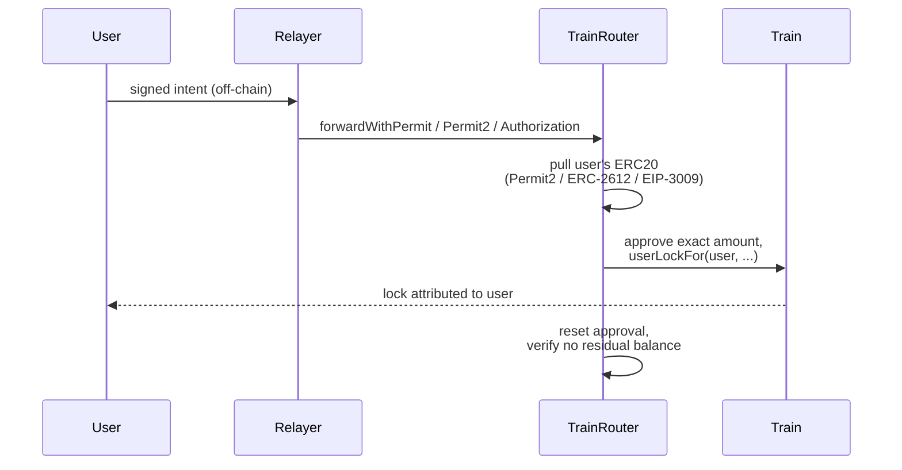

Starting a swap normally costs the user two things: an ERC20 `approve` transaction and the lock transaction itself — both requiring gas on the source chain. TRAIN's gasless flow removes both. The user only **signs a message off-chain**; a relayer (typically the Solver) submits it on-chain and pays the gas, and the funds are locked in the `Train` contract attributed to the user.

On EVM chains and Starknet this is handled by a dedicated contract, the **TrainRouter**. On chains with protocol-level fee abstraction (Tempo, Aztec, Solana), no router is needed — the chain itself provides the gasless mechanism.

## TrainRouter Architecture

The TrainRouter is a **stateless forwarding contract**: it has no owner, no privileged roles, no stored addresses, and it never holds funds between transactions. Its only job is to pull the user's tokens using a gasless token-transfer standard and forward them into `Train.userLockFor` in the same transaction.

### The signed intent

Everything the relayer is allowed to do is fixed by the user's signature. The intent commits to:

`(user, train, token, amount, keccak256(callData), nonce, deadline)`

Because the hash of the full calldata is signed, the relayer can only execute **the exact call the user authorized** — the destination contract, the recipient, the hashlock, the timelock, and every other lock parameter are all locked in by the signature. The Router itself never inspects or interprets the calldata; it is *target-agnostic* by design.

### Three signature paths

The Router supports the three widely adopted gasless-transfer standards, so it works with any mainstream ERC20:

| Path | Standard | How the intent is bound |
| --- | --- | --- |
| `forwardWithPermit` | ERC-2612 permit | A separate EIP-712 intent signature, verified with `SignatureChecker` — works for EOAs **and** ERC-1271 smart accounts |
| `forwardWithPermit2` | Permit2 (`permitWitnessTransferFrom`) | The intent hash is embedded as the Permit2 **witness** — one signature covers both the transfer and the intent |
| `forwardWithAuthorization` | EIP-3009 (`receiveWithAuthorization`, e.g. USDC) | The intent hash is forced to be the authorization **nonce** — one signature covers both |

### Safety guarantees

- **Exact-amount forwarding.** The Router approves the target for exactly `amount`, makes the call, then resets the approval to zero. The target can never consume more than the user signed for.
- **Conservation check.** After forwarding, the Router asserts its own token balance returned to the pre-pull value. If the target contract fails to consume the funds, the entire transaction reverts and the user keeps their tokens — the Router can never end up custodying a balance.
- **Replay protection.** Every intent carries a user-chosen `nonce` and a `deadline`. The Router records each consumed intent and rejects re-use across **all three paths** — a signed intent executes at most once, and never after its deadline.
- **ERC20 only.** Native assets can't be moved by signature, so the gasless path is ERC20-only; native-asset locks use the direct `userLock` flow. Standard (non-fee-on-transfer, non-rebasing) tokens are expected.

## Payout Curves

Locks created through any path can reference a **payout curve** — a contract implementing `IPayoutCurve` that computes how much of the locked amount the recipient receives at redeem time (any remainder returns to the refund address). The curve is called via `STATICCALL`, so it can never mutate the HTLC state, and `Train` validates EIP-165 support before accepting one.

The single shipped curve, `ConstantPayoutCurve`, returns the full amount — a deliberate no-op that keeps the mechanism extensible for future pricing models. Since anyone can supply a curve when creating a lock, Solvers only fill locks whose payout curve they recognize (the curve address is included in the lock event before they commit).

## Per-Chain Variants

<AccordionGroup>
  <Accordion title="Starknet — TrainRouter ported to Cairo">
    Starknet runs the same `Train` + `TrainRouter` + payout-curve architecture, ported to Cairo. The router follows the same signed-intent forwarding model as the EVM version, adapted to Starknet's account-abstraction-native signature scheme.
  </Accordion>
  <Accordion title="Tempo — no router, native sponsorship">
    Tempo has no native gas token: fees are paid in **pathUSD**, and the chain natively supports transaction batching and fee-payer sponsorship. A sponsor can co-sign and pay the fees of a user's transaction directly, which replaces everything the TrainRouter does. Tempo therefore runs a dedicated `Train` contract variant (no native-asset code paths) and **no TrainRouter at all**.
  </Accordion>
  <Accordion title="Aztec — protocol-level fee abstraction">
    Aztec has fee abstraction built into the protocol: fees are paid in **Fee Juice** (bridged from L1) or covered by a sponsored **Fee Paying Contract (FPC)** acting as a paymaster. Gasless UX comes from the chain itself, so no TRAIN-side router exists on Aztec.
  </Accordion>
  <Accordion title="Solana — native fee-payer separation">
    Solana transactions natively separate the **fee payer** from the instruction signers: every TRAIN lock uses a sponsor wallet as `payer` (fees and rent) while the depositor only authorizes the debit. The gas payer and the depositor are always distinct wallets, with no router contract needed.
  </Accordion>
  <Accordion title="Tron — router with chain-specific addresses">
    Tron runs the same `Train` + `TrainRouter` pair as other EVM chains, but Tron has no CREATE2 factory and uses a different address derivation, so its contract addresses differ from the shared EVM set.
  </Accordion>
</AccordionGroup>

Current contract addresses for every network are listed on the [Deployments](/deployments) page.
